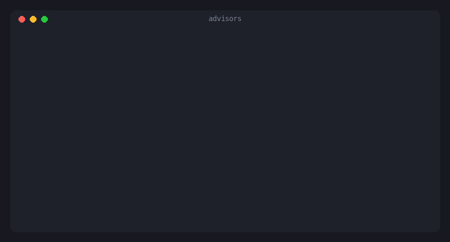
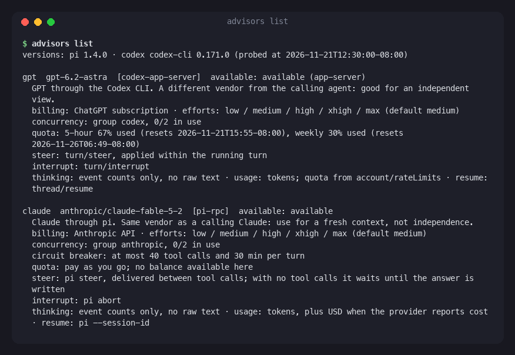
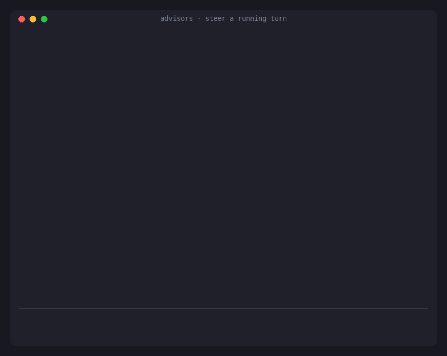
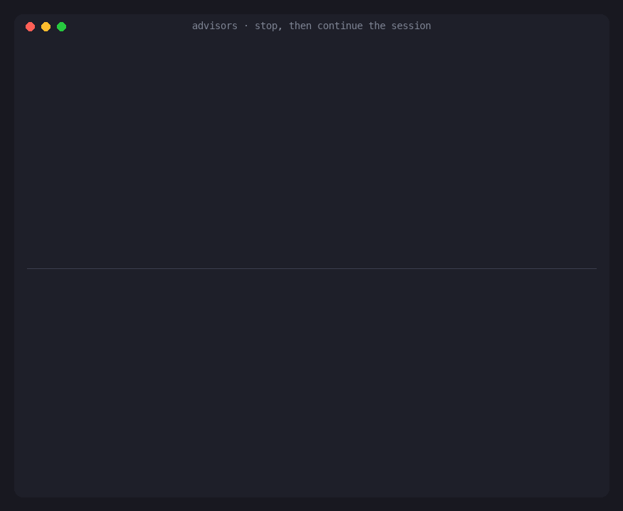

# advisors

[中文](README.zh-CN.md)

Let your coding agent ask other models for a second opinion, the way it uses its own sub-agents.



`advisors` is a single CLI and a small local daemon. Advisors run through [pi](https://github.com/earendil-works/pi) (Anthropic, Vertex AI, OpenAI-compatible APIs, or anything a pi extension adds) or the [Codex CLI](https://github.com/openai/codex). Your agent (Claude Code, or anything with a shell) decides per call whether to wait or run it in the background, and can steer or stop a running turn. Every turn is saved to disk.

## Features

**See who is available.** Lists each advisor's description, quota, concurrency, and capabilities so the agent can pick one.



**Steer a running turn.** Redirect an advisor mid-answer instead of starting over. `steer` reports whether the message was delivered, queued, or too late.



**Stop, then continue.** Stopping keeps the session, so a follow-up question picks up where it left off.



**Rules your agent can't bypass.** Concurrency limits with queueing, a circuit breaker for paid advisors, distinct exit codes when a budget blocks a request or a quota runs out, and idempotency keys so a retry is never charged twice.

**A skill for Claude Code.** [`skill/SKILL.md`](skill/SKILL.md) teaches Claude when to consult advisors and how to run blind reviews and multi-advisor discussions.

## Install

Requires macOS or Linux, Python 3.12+, and a signed-in `pi` or `codex` CLI.

```bash
git clone https://github.com/Yuanforz/advisors.git && cd advisors
pipx install .                     # or run bin/advisors from the checkout
mkdir -p ~/.advisors && cp examples/advisors.toml ~/.advisors/advisors.toml   # then edit it
advisors list
```

For Claude Code, link the skill:

```bash
mkdir -p ~/.claude/skills/advisors && ln -s "$PWD/skill/SKILL.md" ~/.claude/skills/advisors/SKILL.md
```

## Configure

Add a section per advisor in `~/.advisors/advisors.toml`; [`examples/advisors.toml`](examples/advisors.toml) documents every field.

```toml
[advisors.gpt]
backend = "codex-app-server"   # or "pi-rpc" with model = "provider/model"
model = "gpt-6.2-astra"
efforts = ["low", "medium", "high"]
paid = false                   # true enables the circuit breaker
quota = "codex"
description = "What it's good for, what it costs, when not to use it."
```

The agent picks advisors from their descriptions, so write them for the agent. Changes apply without a restart.

## Learn more

- [Usage](docs/usage.md): commands, exit codes, what advisors can see, plugins, data, tests.
- [Design](DESIGN.md): how the daemon, backends and rules fit together.
- [pi extensions](pi-extensions/README.md): `read_many` (several files in one tool call) and `vertex-budget` (a hard spending limit for Vertex AI).

`advisors` drives the official CLIs using your own sign-in and never touches API keys itself. Use each provider within its terms.

## License

[MIT](LICENSE)
