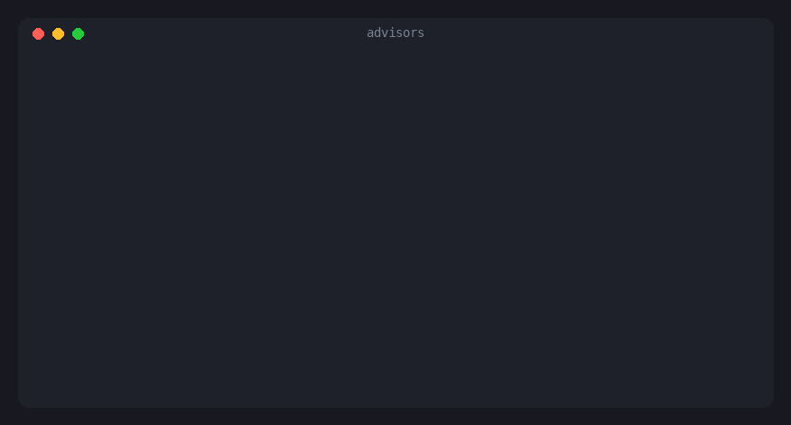
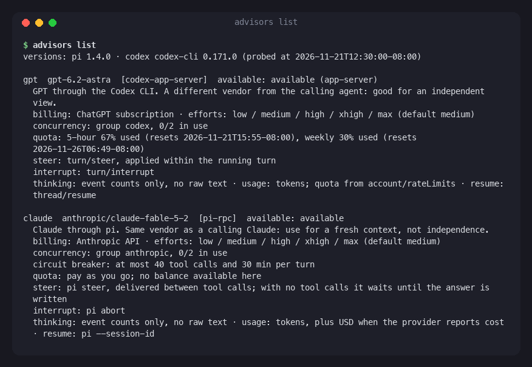
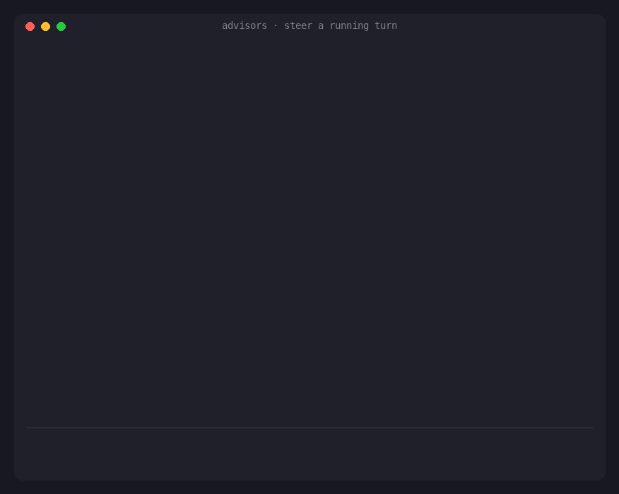
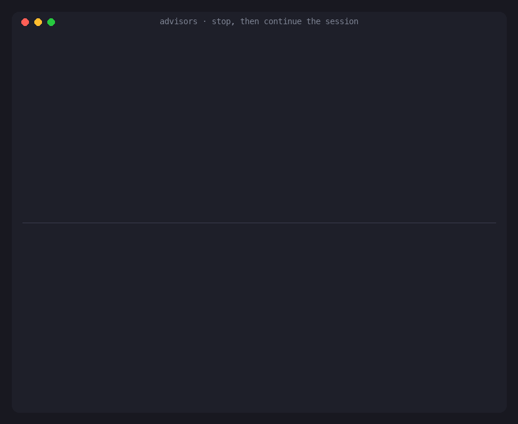

# advisors

[English](README.md)

让你的编程 agent 像调用自带子 agent 一样，向其他模型征求第二意见。



`advisors` 由一个命令行工具和一个本地守护进程组成，支持两种顾问接入方式：

- [pi](https://github.com/earendil-works/pi)：支持 Anthropic、Vertex AI、OpenAI 兼容接口，以及通过 pi 扩展新增的服务商；
- [Codex CLI](https://github.com/openai/codex)。

你的 agent（Claude Code 或任何能执行 shell 的工具）每次调用都可以决定等待结果还是后台运行。执行中途可随时插话或停止，每轮问答都会保存到磁盘。

## 功能

**查看可用顾问。** 列出每个顾问的说明、剩余额度、并发占用和能力，供 agent 据此选择。



**运行途中插话。** 顾问答到一半时可直接纠正方向，不用从头再问。返回结果会说明消息是已送达、排队中，还是来不及了。



**停止后继续追问。** 停止会保留会话，后续提问可从中断处继续。



**agent 无法绕过的规则：**

- 按组限制并发，超出部分排队；
- 为付费顾问提供熔断保护；
- 预算拦截和订阅额度耗尽各有独立退出码；
- 幂等键保证重试不会重复计费。

**Claude Code skill**（[`skill/SKILL.md`](skill/SKILL.md)）：指导 agent 何时该咨询顾问、如何做盲审，以及如何组织多顾问讨论。

## 安装

需要 macOS 或 Linux、Python 3.12+，以及已登录的 `pi` 或 `codex`（任选其一即可）。

```bash
git clone https://github.com/Yuanforz/advisors.git && cd advisors
pipx install .                     # 也可以不装，直接用仓库里的 bin/advisors
mkdir -p ~/.advisors && cp examples/advisors.toml ~/.advisors/advisors.toml   # 然后按需编辑
advisors list
```

在 Claude Code 里用，再链接上 skill：

```bash
mkdir -p ~/.claude/skills/advisors && ln -s "$PWD/skill/SKILL.md" ~/.claude/skills/advisors/SKILL.md
```

## 配置

在 `~/.advisors/advisors.toml` 中为每个顾问添加一个配置段，各字段说明见 [`examples/advisors.toml`](examples/advisors.toml)。

```toml
[advisors.gpt]
backend = "codex-app-server"   # 或 "pi-rpc"，这时 model 写成 "服务商/模型"
model = "gpt-6.2-astra"
efforts = ["low", "medium", "high"]
paid = false                   # 设为 true 会启用熔断
quota = "codex"
description = "擅长什么、花多少钱、什么时候别用。"
```

agent 根据 description 选择顾问，因此请面向 agent 来写。修改配置后无需重启。

## 更多

- [使用说明](docs/usage.md)（英文）：命令、退出码、顾问能看到什么、插件、数据、测试。
- [设计](DESIGN.md)（英文）：守护进程、后端和规则怎么配合。
- [pi 扩展](pi-extensions/README.md)：
  - `read_many`：一次工具调用读多个文件；
  - `vertex-budget`：给 Vertex AI 加硬性花费上限。

`advisors` 使用你自己的登录态调用官方 CLI，本身不接触 API key。请遵守各服务商的使用条款。

## 许可证

[MIT](LICENSE)
